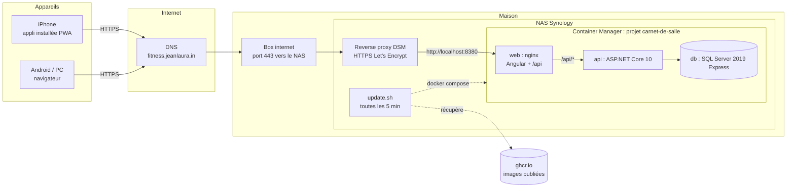
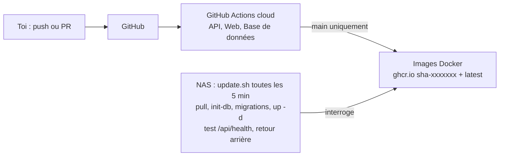

# Architecture

## Vue d'ensemble



- **Un seul domaine** : le front est servi sur `/` et l'API sur `/api`, par le même conteneur nginx. Pas de CORS, et la session tient dans un cookie (voir [authentification.md](authentification.md)).
- **Seul le conteneur `web` est publié** (port 8380 du NAS), et seulement pour le reverse proxy DSM. L'API et SQL Server ne sont joignables que sur le réseau Docker interne.
- **SQL Server** tourne en conteneur, avec ses fichiers dans `/volume1/docker/carnet-de-salle/data/mssql`.

## CI/CD



| Workflow | Quand | Ce qu'il fait |
|---|---|---|
| `ci.yml` | chaque PR et chaque push sur `main` | détecte les fichiers modifiés, lance seulement `api.yml`, `web.yml`, `db.yml` et `docker.yml` concernés, puis publie un statut unique **CI** (celui qu'exige la protection de `main`) |
| `api.yml` | appelé par `ci.yml` et `images.yml` | restore, format, build, tests xUnit, couverture |
| `web.yml` | appelé par `ci.yml` et `images.yml` | `npm ci`, lint, tests, build de production |
| `db.yml` | appelé par `ci.yml` | exécute le schéma de référence et `init-db.sql` sur un vrai SQL Server |
| `docker.yml` | appelé par `ci.yml` (sans publier) et `images.yml` | construit les images, les démarre (API derrière nginx) et vérifie qu'elles répondent, valide `docker-compose.yml`, shellcheck sur les scripts de `deploy/` |
| `images.yml` | push sur `main` touchant `api/`, `web/` ou `deploy/` ; ou à la main | relance les tests, puis `docker.yml`, qui publie les images `sha-xxxxxxx` et `latest` |
| Dependabot | chaque semaine | PR de mise à jour NuGet, npm, Actions, images Docker |

Le **déploiement est tiré par le NAS** : [`deploy/update.sh`](../deploy/update.sh), planifié toutes les 5 minutes, demande à GitHub quelle est la dernière publication réussie sur `main`, télécharge les images et les fichiers de déploiement de ce commit, applique les migrations, redémarre l'appli et vérifie `/api/health`. En cas d'échec, il remet la version précédente et ne réessaie plus cette version.

- Aucun port entrant, aucun runner : GitHub ne peut rien exécuter sur le NAS, ce qui permet de rendre le dépôt public sans risque.
- Une version qui ne passe pas les tests, ou dont les images ne démarrent pas, n'est jamais publiée, donc jamais installée.

**Retour arrière** : dans le `.env` du NAS, `IMAGE_TAG=sha-1a2b3c4` (un tag visible dans Packages), puis `bash update.sh`. Remettre `IMAGE_TAG=` vide pour suivre de nouveau `main`.

## Organisation du dépôt

```text
carnet-de-salle/
├── api/                      API ASP.NET Core 10 (solution CarnetDeSalle)
│   ├── src/CarnetDeSalle.Api/
│   ├── tests/CarnetDeSalle.Api.Tests/
│   └── Dockerfile
├── web/                      Angular (PWA), servi par nginx
│   ├── nginx.conf
│   └── Dockerfile
├── db/
│   ├── schema.sql            schéma de référence (validé en CI)
│   ├── seed/programme.json   programme actuel (exercices, séances A et B)
│   └── ci/                   scripts de test de la CI
├── deploy/
│   ├── docker-compose.yml    production sur le NAS
│   ├── .env.example          modèle des secrets (le vrai .env reste sur le NAS)
│   ├── sql/init-db.sql       base + compte SQL de l'API
│   ├── backup.sh             sauvegarde quotidienne
│   └── update.sh             mise à jour automatique (planifiée sur le NAS)
├── docs/                     cette documentation
└── docker-compose.dev.yml    SQL Server pour développer en local
```

## Choix techniques

| Sujet | Choix | Pourquoi |
|---|---|---|
| API | ASP.NET Core 10 (LTS), minimal API, EF Core 10 | ton choix ; LTS jusqu'en novembre 2028 |
| Base | SQL Server 2019 Express en conteneur | gratuit en production, limite de 10 Go par base largement suffisante, correctifs de sécurité jusqu'en janvier 2030 ; la 2022 et la 2025 ne tiennent pas sur le NAS (noyau Synology 4.4, processeur sans AVX) |
| Front | Angular récent (composants standalone, signals), PWA | ton choix ; installable sur l'iPhone |
| Auth | Identity + cookie, Google, Apple, passkeys | voir [authentification.md](authentification.md) |
| Images | GitHub Container Registry (privé) | gratuit, lié au dépôt |
| Déploiement | mise à jour tirée par le NAS (`update.sh`) + docker compose | NAS derrière une box, pas de port entrant, dépôt publiable sans risque |
| Doc de l'API | OpenAPI (`/openapi/v1.json`) + Scalar en dev | à tester avec Bruno ou le fichier `.http` |

## Contrat d'API (proposition)

Toutes les routes sont sous `/api`, au format JSON, et toutes (sauf santé et connexion) exigent d'être connecté. Les données sont toujours filtrées par l'utilisateur connecté.

| Méthode et route | Rôle |
|---|---|
| `GET /health` | santé (utilisé par le déploiement) |
| `GET /auth/me`, `POST /auth/logout` | session |
| `POST /auth/google`, `POST /auth/apple` | connexion par ID token |
| `POST /auth/passkey/...` | passkeys (voir authentification.md) |
| `GET/PUT /profile` | profil (date de naissance, taille, activité, objectif) |
| `GET /program` | programme actif : séances types, exercices, conseils |
| `GET /program/today` | séance proposée (A, B, C...) avec la charge conseillée par exercice |
| `GET /program/versions` | historique des versions du programme |
| `POST /program/versions` | nouvelle version (programme complet modifié) ; renvoie les notes de version générées |
| `POST /program/versions/{version}/restore` | revenir à une ancienne version (crée une nouvelle version identique) |
| `GET /exercises?muscles&q` | catalogue d'exercices (communs + ceux de l'utilisateur) |
| `POST /exercises` | créer un exercice (nouvelle machine) |
| `GET /workouts?from&to`, `GET /workouts/{id}` | historique |
| `PUT /workouts/{id}` | enregistrer une séance terminée (Id fourni par le front, idempotent) |
| `DELETE /workouts/{id}` | supprimer |
| `POST /workouts/{id}/analysis` | analyse par Claude (phase 4) |
| `GET /stats/lifts` | charges max par exercice dans le temps (onglet Suivi) |
| `GET /weigh-ins`, `PUT /weigh-ins/{date}`, `DELETE /weigh-ins/{date}` | pesées |
| `GET /meals?date`, `PUT /meals/{id}`, `DELETE /meals/{id}` | repas |
| `GET /meals/recent` | les 6 derniers repas distincts |
| `POST /meals/estimate` | estimation par Claude (phase 4) |
| `GET /days/{date}` | bilan du jour : mangé, protéines, séances, dépense, objectif |
| `GET /days?from&to` | bilan sur plusieurs jours (graphique 14 jours) |
| `POST /import/artifact` | import unique des données de l'artefact |
