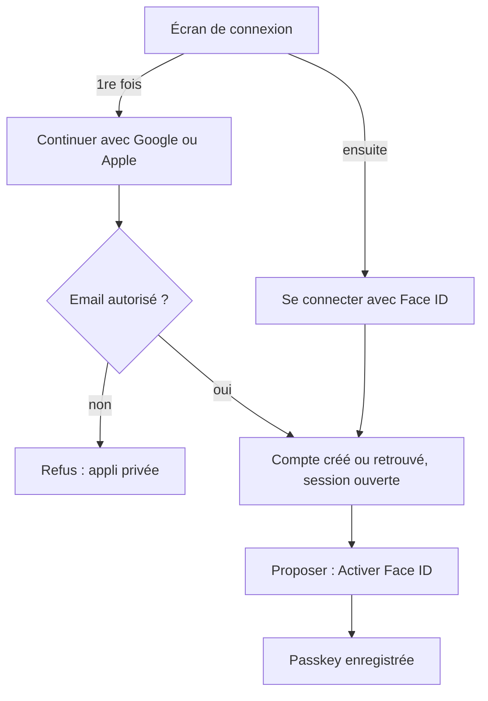

# Authentification

Trois façons de se connecter, toutes gérées par l'API avec **ASP.NET Core Identity (.NET 10)** :

| Méthode | Sur iPhone | Sur Android | Sur PC | Coût |
|---|---|---|---|---|
| **Passkey** | Face ID (ou Touch ID) | empreinte ou visage | Windows Hello, ou QR code avec le téléphone | gratuit |
| **Google** | compte Google | compte Google | compte Google | gratuit |
| **Apple** | identifiant Apple | identifiant Apple | identifiant Apple | compte Apple Developer : 99 $/an |

## Face ID et Android : comment ça marche

Face ID dans une appli web, c'est une **passkey** (standard WebAuthn, le même partout) :

1. Une fois connecté (avec Google ou Apple), tu touches « Activer Face ID ».
2. Le téléphone crée une paire de clés. La clé privée reste dans le trousseau du téléphone (trousseau iCloud sur Apple, gestionnaire de mots de passe Google sur Android) ; l'API ne garde que la clé publique (table `AspNetUserPasskeys`).
3. Les fois suivantes, l'appli demande une signature, le téléphone la débloque avec Face ID ou l'empreinte, et l'API vérifie la signature. Aucun mot de passe ne circule.

Sur Android, c'est exactement le même code : le navigateur demande l'empreinte ou le visage au lieu de Face ID. Sur un PC sans lecteur, le navigateur affiche un QR code à scanner avec le téléphone.

> Une passkey est liée au **domaine** (`fitness.jeanlaura.in`). Changer de domaine plus tard rend les passkeys existantes inutilisables : choisis le domaine avant d'activer les passkeys (ticket « Choisir le domaine »).

## Parcours proposé



- **Inscriptions fermées** : l'appli est personnelle et exposée sur internet. L'API n'accepte que les emails listés dans `Auth__AllowedEmails` (variable d'environnement). Un inconnu qui se connecte avec Google est refusé.
- **Lier plusieurs méthodes** : depuis « Mon compte », on ajoute Google, Apple et plusieurs passkeys au même compte. On ne lie jamais automatiquement deux comptes par leur email (Apple peut masquer l'email avec une adresse relais).
- **Ne jamais se bloquer** : garder au moins deux méthodes actives. L'API refuse de supprimer la dernière.

## Session : cookie, pas de jeton dans le navigateur

Le front Angular et l'API sont servis sur **le même domaine** (`/` pour le front, `/api` pour l'API, voir [architecture.md](architecture.md)). On utilise donc le cookie d'Identity :

- `HttpOnly`, `Secure`, `SameSite=Lax`, durée 30 jours glissants ;
- protection CSRF avec l'antiforgery d'ASP.NET Core sous le nom de cookie `XSRF-TOKEN` et l'en-tête `X-XSRF-TOKEN`, qu'Angular gère tout seul (`provideHttpClient(withXsrfConfiguration(...))`) ;
- les clés Data Protection sont **persistées dans un volume** (`/data/dataprotection`), sinon chaque déploiement déconnecte tout le monde ;
- pas de JWT dans le `localStorage` (plus simple et plus sûr pour une appli d'un seul domaine).

## Passkeys avec .NET 10

Identity gère les passkeys nativement depuis .NET 10 :

```csharp
builder.Services
    .AddIdentityCore<AppUser>(o =>
    {
        o.Stores.SchemaVersion = IdentitySchemaVersions.Version3; // crée AspNetUserPasskeys
    })
    .AddEntityFrameworkStores<AppDbContext>()
    .AddSignInManager();

builder.Services.Configure<IdentityPasskeyOptions>(o =>
{
    o.ServerDomain = builder.Configuration["App:Domain"]; // fitness.jeanlaura.in ; localhost en dev
});
```

Endpoints à exposer (minimal API, groupe `/api/auth/passkey`) :

| Endpoint | Appelle | Rôle |
|---|---|---|
| `POST /creation-options` (connecté) | `SignInManager.MakePasskeyCreationOptionsAsync` | options pour `navigator.credentials.create()` |
| `POST /register` (connecté) | `SignInManager.PerformPasskeyAttestationAsync` puis `UserManager.AddOrUpdatePasskeyAsync` | enregistre la passkey |
| `POST /request-options` | `SignInManager.MakePasskeyRequestOptionsAsync(null)` | options pour `navigator.credentials.get()` (passkeys découvrables) |
| `POST /sign-in` | `SignInManager.PasskeySignInAsync` | vérifie la signature et ouvre la session |
| `GET /` , `DELETE /{id}` (connecté) | `UserManager.GetPasskeysAsync`, suppression | gérer ses passkeys |

Côté Angular : `PublicKeyCredential.parseCreationOptionsFromJSON()` / `parseRequestOptionsFromJSON()` puis `navigator.credentials.create()` / `get()`, et on renvoie `credential.toJSON()` à l'API. Prévoir un repli pour les navigateurs qui n'ont pas encore `parse...FromJSON` (petite fonction de conversion base64url).

Points d'attention :
- limiter le débit (`AddRateLimiter`) sur ces routes ;
- derrière le reverse proxy du NAS, activer `UseForwardedHeaders` pour que l'API voie le bon schéma `https` et le bon hôte ;
- tester les passkeys **en local avec `localhost`**, puis en vrai sur le domaine (un domaine = une passkey).

## Google

Gratuit. Flux « Sign in with Google » (Google Identity Services) qui renvoie un **ID token** au front, vérifié par l'API :

1. [Google Cloud Console](https://console.cloud.google.com/) → nouveau projet « Carnet de salle » → **API et services → Écran de consentement OAuth** (type Externe, mode Test avec ton adresse en testeur, ou Publié).
2. **Identifiants → Créer un ID client OAuth → Application Web**. Origines JavaScript autorisées : `https://fitness.jeanlaura.in` et `http://localhost:4200`.
3. Garder l'**ID client** (pas besoin du secret pour ce flux) → variable `Auth__Google__ClientId` (et `googleClientId` dans la config du front).
4. Front : bouton Google (script `https://accounts.google.com/gsi/client`), qui renvoie `credential` (un JWT).
5. API : `POST /api/auth/google { credential }` → `GoogleJsonWebSignature.ValidateAsync(credential, new() { Audience = [clientId] })` (package `Google.Apis.Auth`) → on retrouve le compte par `AspNetUserLogins` (fournisseur `Google`, clé = `sub`) → `SignInManager.SignInAsync`.

## Apple

Payant : il faut être inscrit à l'**Apple Developer Program** (99 $ par an).

1. [developer.apple.com](https://developer.apple.com/account) → **Identifiers** → créer un **App ID** avec « Sign in with Apple », puis un **Services ID** (ex. `in.jeanlaura.fitness.web`) : c'est le `client_id` côté web.
2. Configurer le Services ID : domaine `fitness.jeanlaura.in`, URL de retour `https://fitness.jeanlaura.in/api/auth/apple/callback` (obligatoire même en mode popup).
3. Front : script « Sign in with Apple JS » avec `usePopup: true` → `AppleID.auth.signIn()` renvoie `authorization.id_token` (et le nom, **seulement à la première connexion** : l'enregistrer tout de suite).
4. API : `POST /api/auth/apple { idToken, name? }` → valider le JWT avec les clés publiques d'Apple (`https://appleid.apple.com/auth/keys`, émetteur `https://appleid.apple.com`, audience = Services ID), puis même logique que Google (fournisseur `Apple`, clé = `sub`).

## Spécificité iPhone : l'appli installée sur l'écran d'accueil

Une PWA lancée depuis l'écran d'accueil s'ouvre en mode « standalone ». Les passkeys y fonctionnent. En revanche, les fenêtres de connexion Google et Apple ouvrent un navigateur intégré, et le comportement du cookie au retour doit être vérifié **sur ton iPhone**. C'est l'objet du ticket « Spike : connexion dans la PWA iPhone », à faire avant de coder toute l'authentification. Si un fournisseur pose problème en mode installé, la parade est simple : créer le compte et la passkey une fois depuis Safari, puis n'utiliser que Face ID dans l'appli installée.
