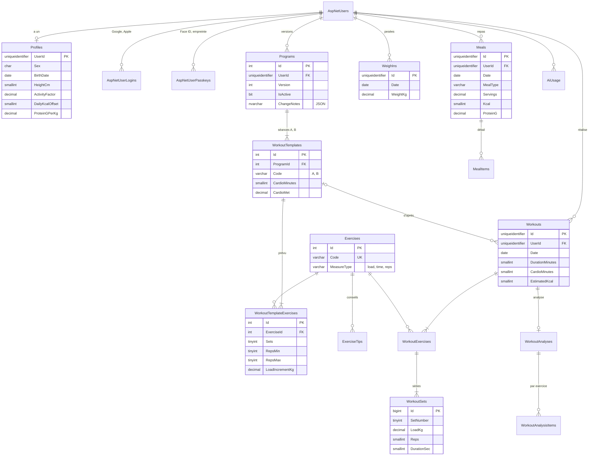

# Base de données

SQL Server 2025 (édition **Express**, gratuite et utilisable en production), dans un conteneur sur le NAS.

- Le schéma métier vit dans le schéma SQL `app`. Les tables d'identité (`dbo.AspNet*`) sont gérées par ASP.NET Core Identity.
- La base est créée et mise à jour par les **migrations EF Core** (code first). Le fichier [`db/schema.sql`](../db/schema.sql) est la **référence** à suivre pour écrire les entités : la CI l'exécute sur un vrai SQL Server à chaque modification (workflow `db.yml`).
- Les noms de tables et de colonnes sont en anglais, pour rester cohérents avec C# et Identity. Le glossaire ci-dessous fait le lien avec les mots de l'appli.

## Glossaire

| Dans l'appli | Table | Remarque |
|---|---|---|
| Profil | `app.Profiles` | sexe, date de naissance, taille, activité, objectif |
| Exercice | `app.Exercises`, `app.ExerciseTips` | catalogue commun, conseils « Comment faire » |
| Programme | `app.Programs` | versionné, un seul actif par utilisateur |
| Séance type (A, B) | `app.WorkoutTemplates`, `app.WorkoutTemplateExercises` | ce qui est prévu |
| Séance réalisée | `app.Workouts`, `app.WorkoutExercises`, `app.WorkoutSets` | ce qui a été fait, série par série |
| Analyse de Claude | `app.WorkoutAnalyses`, `app.WorkoutAnalysisItems` | bilan, avis et consigne par exercice |
| Pesée | `app.WeighIns` | une par jour |
| Repas | `app.Meals`, `app.MealItems` | total mangé + détail du calcul |
| Usage de Claude | `app.AiUsage` | jetons consommés, pour suivre le coût |

## Diagramme

## Tables d'identité (créées par ASP.NET Core Identity)

Avec `AddIdentityCore<AppUser>()` et `options.Stores.SchemaVersion = IdentitySchemaVersions.Version3` (.NET 10), la migration crée notamment :

| Table | Sert à |
|---|---|
| `AspNetUsers` | le compte (clé `uniqueidentifier` : utiliser `IdentityUser<Guid>`) |
| `AspNetUserLogins` | les connexions externes : une ligne par compte Google ou Apple lié |
| `AspNetUserPasskeys` | les passkeys (Face ID, empreinte, Windows Hello) : identifiant, clé publique, compteur, nom |
| `AspNetUserClaims`, `AspNetUserTokens`, `AspNetRoles`... | standards Identity, peu utilisés ici |

Toutes les tables `app.*` qui appartiennent à un utilisateur ont une colonne `UserId` reliée à `AspNetUsers.Id` avec suppression en cascade : supprimer un compte efface toutes ses données (et c'est testé en CI).

## Détail des tables métier

### `app.Profiles`
Une ligne par utilisateur. On stocke la **date de naissance** plutôt que l'âge (l'artefact stockait l'âge), pour que l'âge reste juste dans le temps. `ActivityFactor` vaut 1,2 / 1,375 / 1,55. `DailyKcalOffset` vaut 0, −300 ou −500. Les formules sont dans [regles-metier.md](regles-metier.md).

### `app.Exercises` et `app.ExerciseTips`
Catalogue commun. `Code` est la clé stable utilisée par le front pour choisir l'illustration SVG (`presse`, `hack_squat`, `planche`...). `MeasureType` : `load` (charge × répétitions), `time` (secondes), `reps` (répétitions seules). Les données de départ sont dans [`db/seed/programme.json`](../db/seed/programme.json).

### `app.Programs`, `app.WorkoutTemplates`, `app.WorkoutTemplateExercises`
Le programme est **versionné** : changer le programme crée une nouvelle version et désactive l'ancienne (index unique filtré `UX_Programs_OneActivePerUser`). Les séances réalisées gardent la version et le code (`TemplateCode`) avec lesquels elles ont été faites. `CardioMet` porte le MET utilisé pour estimer les kcal du cardio (tapis incliné 7,0 ; vélo 6,0).

### `app.Workouts`, `app.WorkoutExercises`, `app.WorkoutSets`
Une séance terminée, puis ses exercices, puis ses séries. Le nom de l'exercice est recopié (`ExerciseName`) pour que l'historique reste lisible même si le catalogue change. `EstimatedKcal` est calculé à l'enregistrement (voir règles métier) et peut être recalculé. L'`Id` d'une séance peut être généré par le front (`crypto.randomUUID()`), ce qui rend l'envoi idempotent pour le mode hors ligne.

### `app.WorkoutAnalyses`, `app.WorkoutAnalysisItems`
L'analyse d'une séance : titre, bilan, conseil, puis un avis et une consigne par exercice, avec la charge ou la durée conseillée. `Source = 'manual'` permet de saisir une consigne à la main (c'est le cas de la note sur le hip thrust de l'artefact). La « consigne active » d'un exercice est la plus récente, tant que l'exercice n'a pas été refait après sa date.

### `app.WeighIns`
Une pesée par utilisateur et par jour (`UQ_WeighIns_UserDate`) : enregistrer deux fois le même jour remplace la valeur (upsert côté API).

### `app.Meals`, `app.MealItems`
`Kcal`, `ProteinG`, `CarbsG`, `FatG` sont les **totaux mangés** (portions comprises). Les valeurs pour une portion se retrouvent en divisant par `Servings`. `MealItems` garde le détail du calcul de Claude, pour une portion. `MealType` : `breakfast`, `lunch`, `snack`, `dinner` (petit-déj, déjeuner, en-cas, dîner).

### `app.AiUsage`
Une ligne par appel à l'API Claude (phase 4) : modèle, jetons d'entrée et de sortie, succès. Sert à afficher et plafonner le coût.

## Correspondance avec les données de l'artefact

| Artefact (`db` du Carnet de salle) | Base SQL |
|---|---|
| `seances/{id}` : `date`, `seance`, `version`, `echauffement`, `cardioMin`, `dureeMin`, `note` | `app.Workouts` |
| `seances/{id}.exercices[]` : `id`, `nom`, `type` | `app.WorkoutExercises` (`type` charge → `load`, temps → `time`) |
| `seances/{id}.exercices[].series[]` : `kg`, `reps`, `sec` | `app.WorkoutSets` |
| `seances/{id}.analyse` | `app.WorkoutAnalyses` + `app.WorkoutAnalysisItems` |
| `poids/{date}` : `kg` | `app.WeighIns` |
| `repas/{id}` : `moment`, `nom`, `kcal`, `prot`, `gluc`, `lip`, `portions`, `elements[]` | `app.Meals` + `app.MealItems` (petitdej → breakfast, dejeuner → lunch, collation → snack, diner → dinner) |
| `profil/moi` : `age`, `taille`, `activite`, `ecart` | `app.Profiles` (l'âge devient une date de naissance) |
| `PROGRAMME` (dans le code de l'artefact) | `app.Programs` + séances types + exercices, voir `db/seed/programme.json` |
